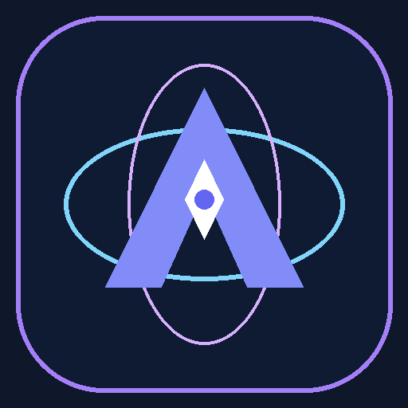

# 🚀 AradGPT Pro | سامانه جامع هوش مصنوعی چندرسانه‌ای و دستیار هوشمند

<div align="center">



### **Next-Generation Multi-Model AI SaaS & Studio**
### **پلتفرم نسل جدید چت هوشمند، تولید تصویر، پردازش صوت، کیف پول ریالی و پنل مدیریت**

[](https://python.org)
[](https://streamlit.io)
[](https://platform.openai.com)
[](LICENSE)
[](https://github.com/ebi19912/AI-AradGPT-Pro)

[English Documentation](#-english-documentation) • [راهنمای فارسی](#-راهنمای-جامع-فارسی)

</div>

---

## 📑 Table of Contents / فهرست مطالب
- [English Documentation](#-english-documentation)
  - [Overview](#-overview)
  - [Key Features](#-key-features)
  - [Supported AI Models](#-supported-ai-models)
  - [Project Architecture](#-project-architecture)
  - [Tech Stack](#-tech-stack)
  - [Installation & Quickstart](#-installation--quickstart)
  - [Configuration](#-configuration)
  - [Database & Admin Account](#-database--admin-account)
- [راهنمای جامع فارسی](#-راهنمای-جامع-فارسی)
  - [معرفی پروژه](#-معرفی-پروژه)
  - [قابلیت‌های برجسته](#-قابلیت‌های-برجسته)
  - [مدل‌های هوش مصنوعی پشتیبانی‌شده](#-مدل‌های-هوش-مصنوعی-پشتیبانی‌شده)
  - [ساختار فایل‌ها و معماری](#-ساختار-فایل‌ها-و-معماری)
  - [راهنمای نصب و راه‌اندازی](#-راهنمای-نصب-و-راه‌اندازی)
  - [تنظیمات و پیکربندی API](#-تنظیمات-و-پیکربندی-api)
  - [اطلاعات ورود ادمین و ابزار تعمیر](#-اطلاعات-ورود-ادمین-و-ابزار-تعمیر)
  - [لایسنس و سازنده](#-لایسنس-و-سازنده)

---

# 🌐 English Documentation

## 📖 Overview
**AradGPT Pro** is a modern, enterprise-ready AI SaaS platform and multimedia workspace built on top of **Streamlit** and an **OpenAI-compatible gateway (GapGPT / OpenAI API)**.

It provides a unified hub for next-generation Large Language Models (OpenAI GPT-5/4o/o1/o3, Anthropic Claude 3.5/3.7, Google Gemini 2.5/3.0, Grok-3/4, DeepSeek R1/V3, Alibaba Qwen), text-to-image/image-to-image studios (Flux.1, DALL-E 3, Imagen 4), speech-to-text (Whisper), text-to-speech (TTS), a real-time Toman wallet billing system, and a comprehensive superadmin dashboard.

---

## ✨ Key Features

### 1. 💬 Smart Chat Studio (`views/chat.py`)
- **Multi-Model Intelligence**: Seamlessly switch between frontier reasoning, coding, and chat models.
- **Real-Time Streaming**: Low-latency token-by-token response streaming.
- **Document Analysis & RAG**: Upload and analyze `.pdf`, `.docx`, `.txt`, and `.csv` files directly in the chat.
- **Session Management**: Automatically persist, switch, and delete conversation threads with unique titles.
- **Accurate Token Metering**: Calculates exact input/output tokens with `tiktoken` and deducts cost in Toman in real-time.

### 2. 🎨 Graphic & Image Studio (`views/image.py`)
- **Text-to-Image Generation**: Produce photorealistic images using FLUX.1 (Schnell & Dev), DALL-E 3, Imagen 4.0 (Fast/Ultra), and Gemini.
- **Image-to-Image (Variations)**: Upload PNG images to generate variations.
- **Dynamic Cost Display**: Automatic calculation and transparent pricing per image.

### 3. 🎙️ Audio & Voice Studio (`views/audio.py`)
- **Text-to-Speech (TTS)**: Convert text to lifelike voiceovers using 6 voice personalities (`alloy`, `echo`, `fable`, `onyx`, `nova`, `shimmer`).
- **Speech-to-Text (STT)**: Transcribe voice messages or uploaded audio files (`.mp3`, `.wav`, `.ogg`) using OpenAI Whisper.
- **Live Voice Recording**: Directly record audio via browser microphone and get instant transcriptions.

### 4. 💳 Wallet & Financial Hub (`views/wallet.py`)
- **Real-Time Balance Display**: Live wallet balance tracking in Iranian Toman.
- **Bank Account Integration**: Displays official admin bank cards and IBANs (Sheba).
- **Deposit Receipt Upload**: Users can submit bank transfer receipt screenshots with amount details.
- **Audit Logs**: Transparent history of transactions, token usage, and costs.

### 5. ⚙️ Superadmin Control Center (`views/admin.py`)
- **Deposit Verification**: Preview uploaded receipt images, approve with instant wallet crediting, or reject requests.
- **User Management**: Create accounts, set initial credit, update passwords, adjust balances manually, or delete users.
- **Bank Account Management**: Add or remove bank account cards and Sheba numbers.
- **Business Intelligence & Analytics**: Total platform revenue tracker, full audit logs, and model usage distribution charts.

### 6. 💎 Modern Glassmorphic UI/UX (`modules/ui.py`)
- **Qwen-Inspired Dark & Glass Theme**: Sleek gradients, glassmorphism cards, and refined typography.
- **Full RTL & Persian Typography**: Embedded `Vazirmatn`, `Shabnam`, `Tanha`, and `Yekan` font support.
- **Floating Action Buttons**: Instant one-click conversation copy and smooth scroll-to-bottom actions.

---

## 🤖 Supported AI Models

| Category | Supported Models |
| :--- | :--- |
| **OpenAI GPT Series** | `gpt-5`, `gpt-5-mini`, `gpt-5-nano`, `gpt-5.1`, `gpt-5.2`, `gpt-5.2-pro`, `gpt-5-codex`, `gpt-4o`, `gpt-4o-mini`, `gpt-4.5-preview`, `gpt-4.1` |
| **OpenAI Reasoning (o-series)** | `o1`, `o1-mini`, `o3`, `o3-mini`, `o3-mini-high`, `o3-mini-low`, `o4-mini` |
| **xAI Grok** | `grok-4`, `grok-3`, `grok-3-fast`, `grok-3-mini`, `grok-3-mini-fast` |
| **Google Gemini & Gemma** | `gemini-3-pro-preview`, `gemini-2.5-pro`, `gemini-2.5-flash`, `gemini-2.0-flash`, `gemma-3-27b-it` |
| **Anthropic Claude** | `claude-3-7-sonnet`, `claude-3-7-sonnet-thinking`, `claude-3-5-sonnet`, `claude-3-5-haiku`, `claude-opus-4-1` |
| **DeepSeek & Alibaba** | `deepseek-reasoner` (R1), `deepseek-chat` (V3), `qwen3-coder-480b`, `qwen3-235b` |
| **Image Generation** | `gapgpt/flux.1-schnell`, `gapgpt/flux.1-dev`, `dall-e-3`, `dall-e-2`, `imagen-4.0-ultra`, `gemini-3-pro-image` |
| **Audio (TTS & STT)** | `gpt-4o-mini-tts`, `tts-1`, `tts-1-hd`, `gemini-2.5-pro-tts`, `whisper-1`, `gapgpt/whisper-1` |

---

## 📁 Project Architecture

```
AI-AradGPT-Pro/
│
├── app.py                       # Main application entry point & routing
├── repair.py                    # Database repair, reset & admin recovery tool
├── requirements.txt             # Python dependencies
├── .gitignore                   # Git ignore specifications
│
├── assets/
│   └── logo.png                 # Application logo and icons
│
├── fonts/                       # Local Persian fonts
│   ├── Shabnam.ttf
│   ├── Tanha.ttf
│   ├── Vazir.ttf
│   └── Yekan.ttf
│
├── modules/                     # Backend core logic
│   ├── __init__.py
│   ├── auth.py                  # Authentication & SHA-256 password verification
│   ├── database.py              # SQLite models, CRUD operations & sessions
│   ├── pricing.py               # Dynamic pricing engine & USD-to-Toman converter
│   ├── ui.py                    # Qwen styling, RTL CSS, fonts & floating buttons
│   └── utils.py                 # Token counting (tiktoken) & file parser (PDF/DOCX)
│
├── views/                       # Streamlit UI Views
│   ├── __init__.py
│   ├── admin.py                 # Admin dashboard (Users, Deposits, Banks, Analytics)
│   ├── audio.py                 # TTS & STT Audio Studio
│   ├── chat.py                  # Smart Chat interface with streaming & file attach
│   ├── image.py                 # Text-to-Image & Variation Studio
│   └── wallet.py                # User wallet, bank list & deposit submission
│
└── .streamlit/
    └── secrets.toml.example     # Template for API keys & secrets
```

---

## 🛠️ Tech Stack

- **Frontend / Framework**: [Streamlit](https://streamlit.io/)
- **AI Gateway & Client**: [OpenAI Python SDK](https://github.com/openai/openai-python) (Connecting to GapGPT / OpenAI endpoint)
- **Token Calculation**: [tiktoken](https://github.com/openai/tiktoken)
- **Document Processing**: [PyPDF2](https://pypdf2.readthedocs.io/), [python-docx](https://python-docx.readthedocs.io/)
- **Image Processing**: [Pillow](https://python-pillow.org/)
- **Database**: [SQLite3](https://www.sqlite.org/) with [Pandas](https://pandas.pydata.org/)
- **Security**: SHA-256 Password Hashing

---

## 🚀 Installation & Quickstart

### Prerequisites
- Python **3.10** or higher
- Git

### 1. Clone the Repository
```bash
git clone https://github.com/ebi19912/AI-AradGPT-Pro.git
cd AI-AradGPT-Pro
```

### 2. Create and Activate a Virtual Environment
```bash
# Windows
python -m venv .venv
.venv\Scripts\activate

# Linux / macOS
python3 -m venv .venv
source .venv/bin/activate
```

### 3. Install Dependencies
```bash
pip install -r requirements.txt
```

### 4. Configure API Key
Create a `.streamlit/secrets.toml` file in the project root:
```toml
# .streamlit/secrets.toml
GAP_API_KEY = "your_gapgpt_or_openai_api_key_here"
```

*(Optional)* You can customize the USD to Toman conversion rate via an environment variable:
```bash
# Windows (PowerShell)
$env:USD_TO_TOMAN="85000"

# Linux / macOS
export USD_TO_TOMAN=85000
```

### 5. Launch the Application
```bash
streamlit run app.py
```
Open your browser and navigate to `http://localhost:8501`.

---

## 🗄️ Database & Admin Account

When you start `app.py` for the first time, SQLite initializes `data/gapgpt.db` automatically with a default administrator:

- **Username**: `admin`
- **Password**: `admin123`
- **Initial Balance**: `5,000,000` Tomans
- **Role**: `admin`

> [!TIP]
> If you ever need to reset the database or restore the default admin account, simply execute:
> ```bash
> python repair.py
> ```

---

<br>

# 🇮🇷 راهنمای جامع فارسی

## 📖 معرفی پروژه
**AradGPT Pro** یک پلتفرم هوش مصنوعی چندمنظوره و پیشرفته به زبان پایتون و مبتنی بر فریم‌ورک **Streamlit** است که از طریق گیت‌وی سازگار با OpenAI (سرویس GapGPT / OpenAI) به تمام مدل‌های پرچمدار و پیشرو هوش مصنوعی در جهان متصل می‌شود.

این سامانه مجهز به محیط چت هوشمند با امکان پردازش اسناد، استودیوی ساخت و ویرایش تصویر، استودیوی پیشرفته تبدیل متن به صوت (TTS) و صوت به متن (STT)، کیف پول ریالی به همراه سیستم بررسی فیش بانکی، و پنل مدیریت کامل است.

---

## ✨ قابلیت‌های برجسته

### ۱. 💬 چت هوشمند چند مدله (`views/chat.py`)
- **دسترسی به قدرتمندترین مدل‌های هوش مصنوعی دنیا**: سوئیچ آنی میان مدل‌های استدلالی، برنامه‌نویسی و عمومی (GPT-5، Claude 3.7، Gemini 2.5، Grok 3، DeepSeek R1 و Qwen 3).
- **پاسخ‌دهی استریم (زنده)**: تایپ زنده‌ی کلمات بدون معطلی و با سرعت بالا.
- **پردازش و خواندن اسناد**: پشتیبانی از فایل‌های متنی و اسناد با پسوندهای `PDF`، `Word (DOCX)`، `TXT` و `CSV`.
- **مدیریت نشست‌های گفتگو (Sessions)**: ذخیره تاریخچه گفتگوها، امکان جابجایی بین چت‌ها و حذف آسان نشست‌ها.
- **محاسبه دقیق هزینه توکن‌ها**: محاسبه لحظه‌ای توکن‌های ورودی و خروجی با کتابخانه `tiktoken` و کسر مبلغ دقیق به تومان از حساب کاربر.

### ۲. 🎨 استودیو تصویر و گرافیک (`views/image.py`)
- **تولید تصویر از متن (Text-to-Image)**: خلق تصاویر فوق‌العاده با موتورهای قدرتمند FLUX.1 (Dev و Schnell)، DALL-E 3، Imagen 4.0 و Gemini.
- **ویرایش و ایجاد تنوع در تصویر (Image Variations)**: آپلود تصویر و بازتولید نسخه‌های متنوع بر پایه آن.
- **محاسبه هوشمند هزینه**: نمایش تعرفه ریالی قبل از تولید و کسر خودکار پس از دریافت نتیجه.

### ۳. 🎙️ استودیو صوت و گویندگی (`views/audio.py`)
- **تبدیل متن به گفتار (TTS)**: تولید صدای بسیار طبیعی با ۶ گوینده اختصاصی (`Alloy`، `Echo`، `Fable`، `Onyx`، `Nova`، `Shimmer`) با مدل‌های صوتی OpenAI و گوگل.
- **تبدیل گفتار به متن (STT / Whisper)**: پیاده‌سازی متن فایل‌های صوتی ضبط شده یا آپلود شده با دقت بالا در زبان فارسی و انگلیسی.
- **ضبط مستقیم صدا از مرورگر**: ارسال وویس مستقیم با میکروفون و دریافت متن فوری.

### ۴. 💳 کیف پول و درگاه مالی ریالی (`views/wallet.py`)
- **نمایش لحظه‌ای موجودی حساب** به تومان.
- **مشاهده کارت‌ها و شماره شبای بانکی** ثبت‌شده توسط مدیریت.
- **ثبت فیش و رسید واریز**: آپلود تصویر فیش بانکی و ثبت درخواست شارژ حساب.
- **گزارش شفاف تراکنش‌ها**: مشاهده لاگ دقیق مصرف توکن‌ها و هزینه‌ها برای کاربر.

### ۵. ⚙️ پنل فوق‌پیشرفته مدیریت (`views/admin.py`)
- **بررسی و تایید واریزی‌ها**: مشاهده پیش‌نمایش تصویر فیش واریزی و تایید (با افزایش خودکار موجودی کاربر) یا رد درخواست با یک کلیک.
- **مدیریت کاربران**: تعریف کاربر جدید، تعیین موجودی اولیه، ویرایش کلمه عبور، شارژ یا کسر دستی موجودی و حذف کاربر.
- **مدیریت حساب‌های بانکی**: افزودن و حذف شماره کارت‌ها و شماره شبای پذیرنده.
- **آمار و گزارش‌های مالی**: نمایش درآمد کل سیستم، نمودار تفکیکی مصرف مدل‌ها و لیست جامع تمامی لاگ‌ها.

### ۶. 💎 رابط کاربری مدرن شیشه‌ای (Glassmorphism UI)
- **قالب تاریک و مدرن الهام‌گرفته از Qwen**: استفاده از گرادیان‌های جذاب و افکت شیشه‌ای (Blured Backdrop).
- **فونت‌های اختصاصی فارسی**: تعبیه فونت‌های استاندارد فارسی شامل **وزیرمتن (Vazirmatn)**، **شبنم**، **تنها** و **یکان**.
- **دکمه‌های شناور (Floating Action Buttons)**: دکمه اختصاصی کپی کل متن گفتگو و دکمه اسکرول نرم به پایین صفحه.

---

## 📁 ساختار فایل‌ها و معماری پروژه

```
AI-AradGPT-Pro/
│
├── app.py                       # فایل اصلی برنامه و مسیریابی صفحات
├── repair.py                    # اسکریپت تعمیر، ساخت مجدد دیتابیس و بازیابی ادمین
├── requirements.txt             # کتابخانه‌ها و پیش‌نیازهای پایتونی
├── .gitignore                   # تنظیمات فایل‌های نادیده‌گرفته‌شده گیت
│
├── assets/
│   └── logo.png                 # لوگوی برنامه
│
├── fonts/                       # فونت‌های فارسی پروژه
│   ├── Shabnam.ttf
│   ├── Tanha.ttf
│   ├── Vazir.ttf
│   └── Yekan.ttf
│
├── modules/                     # ماژول‌ها و لاجیک بک‌اند
│   ├── __init__.py
│   ├── auth.py                  # ماژول احراز هویت و بررسی هش رمز عبور
│   ├── database.py              # ساختار جداول SQLite و توابع CRUD دیتابیس
│   ├── pricing.py               # دیتابیس قیمت مدل‌ها و نرخ تبدیل ارز
│   ├── ui.py                    # استایل‌های CSS، تنظیمات RTL و دکمه‌های شناور
│   └── utils.py                 # شمارنده توکن‌ها (tiktoken) و خواننده فایل اسناد
│
├── views/                       # رابط کاربری و صفحات برنامه
│   ├── __init__.py
│   ├── admin.py                 # پنل ادمین (کاربران، فیش‌ها، بانک، آمار)
│   ├── audio.py                 # استودیو پردازش صوت (TTS / STT)
│   ├── chat.py                  # صفحه چت هوشمند و خواندن فایل‌ها
│   ├── image.py                 # استودیو ساخت و ویرایش تصویر
│   └── wallet.py                # صفحه کیف پول، حساب‌های بانکی و ارسال رسید
│
└── .streamlit/
    └── secrets.toml.example     # نمونه فایل کلید‌های خصوصی و متغیرها
```

---

## 🚀 راهنمای نصب و راه‌اندازی سریع

### پیش‌نیازها
- پایتون نسخه **3.10** یا بالاتر
- نرم‌افزار Git

### ۱. کلون کردن مخزن گیت‌هاب
```bash
git clone https://github.com/ebi19912/AI-AradGPT-Pro.git
cd AI-AradGPT-Pro
```

### ۲. ساخت و فعال‌سازی محیط مجازی (Virtual Environment)
```bash
# در ویندوز (PowerShell یا CMD)
python -m venv .venv
.venv\Scripts\activate

# در لینوکس یا مک
python3 -m venv .venv
source .venv/bin/activate
```

### ۳. نصب کتابخانه‌ها
```bash
pip install -r requirements.txt
```

### ۴. تنظیم کلید API
پوشه‌ای به نام `.streamlit` بسازید و فایلی با نام `secrets.toml` در آن ایجاد کنید:
```toml
# .streamlit/secrets.toml
GAP_API_KEY = "کلید_ای_پی_ای_شما"
```

*(اختیاری)* برای تغییر نرخ تبدیل پیش‌فرض دلار به تومان (پیش‌فرض ۸۰,۰۰۰ تومان):
```bash
# در ویندوز
$env:USD_TO_TOMAN="85000"

# در لینوکس / مک
export USD_TO_TOMAN=85000
```

### ۵. اجرای برنامه
```bash
streamlit run app.py
```
سپس آدرس `http://localhost:8501` را در مرورگر خود باز کنید.

---

## 🔑 اطلاعات ورود ادمین و ابزار تعمیر

هنگام اولین اجرای برنامه، دیتابیس به صورت خودکار در مسیر `data/gapgpt.db` ساخته شده و کاربر ادمین پیش‌فرض ایجاد می‌شود:

| فیلد | مقدار پیش‌فرض |
| :--- | :--- |
| **نام کاربری** | `admin` |
| **رمز عبور** | `admin123` |
| **موجودی اولیه** | `5,000,000` تومان |
| **سطح دسترسی** | `admin` |

> [!NOTE]
> در صورت نیاز به بازنشانی پایگاه داده یا ساخت مجدد کاربر ادمین، دستور زیر را در ترمینال اجرا کنید:
> ```bash
> python repair.py
> ```

---

## 🤝 مشارکت و توسعه (Contributing)
از پیشنهادات، رفع باگ‌ها و بهبود قابلیت‌ها استقبال می‌شود!
1. مخزن را فورک (Fork) کنید.
2. یک برنچ برای قابلیت جدید ایجاد کنید (`git checkout -b feature/NewFeature`).
3. تغییرات را کامیت کنید (`git commit -m 'Add NewFeature'`).
4. تغییرات را پوش کرده (`git push origin feature/NewFeature`) و یک Pull Request ارسال فرمایید.

---

## 📄 لایسنس (License)
این پروژه تحت لایسنس **MIT** منتشر شده است. برای اطلاعات بیشتر فایل `LICENSE` را مطالعه کنید.

<div align="center">
  <b>طراحی و توسعه داده شده برای جامعه متن‌باز فارسی 🇮🇷</b>
</div>
